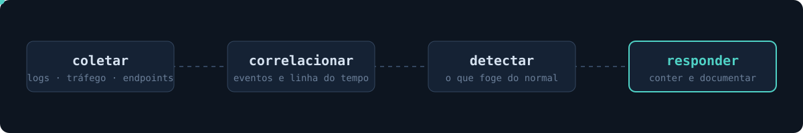

```console
~ $ cat sobre.txt
```

Comecei no suporte, atendendo usuários e mantendo ambientes de pé. Foi ali que aprendi o que mais uso em segurança: conhecer bem o que é normal para perceber rápido o que não é. Hoje sou formado em Defesa Cibernética e quero levar isso para um time de SOC.

```console
~ $ ./workflow.sh
```



```console
~ $ tree formacao/
formacao/
├── defesa-cibernetica    FIAP, 2026
├── red-hat-academy       RH124 + RH134 (administração Linux)
├── claude-code           trilha Anthropic
└── idiomas               português nativo, inglês C1
```

```console
~ $ ping david
```

[](https://www.linkedin.com/in/david-karagulian)
[](mailto:david.karagulian505@gmail.com)
